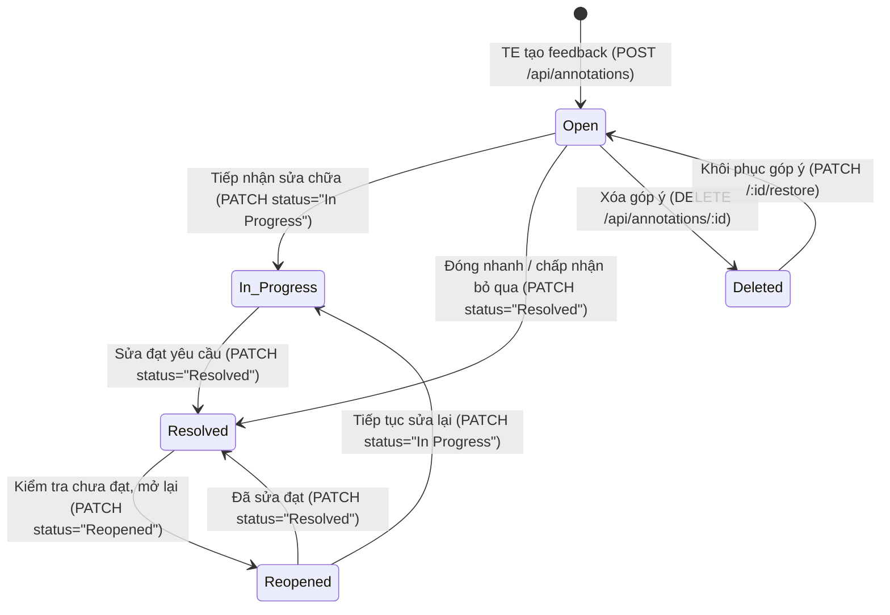

# Tài liệu Thiết kế Kiểm thử: Góp ý Biên tập & Tiến độ Bản thảo (Tantou Editor Feedback & Progress)

> **Môn học:** Kiểm thử & Đảm bảo Chất lượng Phần mềm (KCPM)  
> **Module nghiệp vụ:** Tantou Editor Feedback & Theo dõi/Cập nhật Tiến độ Biên tập Chapter  
> **Đối tượng áp dụng:** Tantou Editor, Admin, Mangaka, Assistant  
> **Căn cứ kỹ thuật:** Các route backend `annotation.routes.js`, `chapter.routes.js`, `series.routes.js`, service `annotationService.js` và model `AnnotationModel.js`, `ChapterModel.js`.

---

## 1. Tổng quan & Phạm vi Nghiệp vụ

Tài liệu này bao phủ toàn bộ thiết kế kiểm thử hộp đen (Black-box Test Design) theo các kỹ thuật chuẩn: **Phân vùng tương đương (Equivalence Partitioning - EP)**, **Phân tích giá trị biên (Boundary Value Analysis - BVA)**, **Bảng ca kiểm thử chi tiết (Test Cases with Single Fault)** và **Kiểm thử chuyển đổi trạng thái (State Transition Testing)** cho các chức năng sau:
1. **Tạo và quản lý góp ý biên tập (Annotation / Feedback):** Tantou Editor tạo phản hồi trên từng trang bản thảo (`page_id`), định vị tọa độ lỗi (`x`, `y`), cập nhật nội dung, trạng thái xử lý (`Open`, `In Progress`, `Resolved`, `Reopened`), gia hạn deadline, xóa mềm và khôi phục góp ý.
2. **Cập nhật & kiểm soát trạng thái tiến độ bản thảo Chapter:** Tantou Editor đánh giá bản thảo, chuyển đổi trạng thái chương truyện (`Draft`, `In Production`, `Waiting Review` / `In Review`, `Need Revision`, `Approved`, `Published`).
3. **Theo dõi tiến độ sản xuất biên tập:** Truy vấn báo cáo tổng hợp tiến độ hoàn thành (`completionPercent`, số lượng task/annotation tồn đọng, cảnh báo trễ hạn).
4. **Kiểm soát phân quyền & phạm vi phụ trách (RBAC & Scope):** Đảm bảo Tantou Editor chỉ được can thiệp vào các Series/Chapter được phân công phụ trách (`requireChapterScope`, `requirePageScope`), chặn các vai trò trái phép (`Member`, `Guest`, `Assistant` vượt quyền).

---

## 2. Phân tích Phân vùng Tương đương (EP) & Phân tích Giá trị Biên (BVA)

### Quy ước Đặt mã Tag:
* **`V` (Valid Partition):** Phân vùng tương đương hợp lệ.
* **`X` (Invalid Partition):** Phân vùng tương đương không hợp lệ.
* **`B` (Boundary / Representative Value):** Giá trị biên hoặc dữ liệu kiểm thử đại diện.

---

### 2.1. Nội dung Góp ý / Feedback (`content` / `comment`)
* **Đặc tả nghiệp vụ:** Chuỗi văn bản không được rỗng, độ dài hợp lệ từ 1 đến 2000 ký tự (hỗ trợ Unicode, tiếng Việt, ký tự đặc biệt).

| Trường dữ liệu | Phân vùng hợp lệ | Tag | Phân vùng không hợp lệ | Tag | Giá trị biên / Dữ liệu kiểm thử đại diện | Tag |
| :--- | :--- | :---: | :--- | :---: | :--- | :---: |
| **Nội dung góp ý** (`content` / `comment`) | Chuỗi có độ dài từ 1 – 2000 ký tự hợp lệ; chứa ký tự Unicode/tiếng Việt | V1 V2 | Bỏ trống / undefined / null Chuỗi chỉ chứa khoảng trắng (`whitespace`) Chuỗi vượt quá 2000 ký tự | X1 X2 X3 | `1 ký tự ("A")` `2 ký tự ("OK")` `500 ký tự (văn bản góp ý chuẩn)` `1999 ký tự` `2000 ký tự` `2001 ký tự` `Chuỗi rỗng ""` / `null` `"    "` (chỉ khoảng trắng) `"Cần vẽ lại khung thoại trang 3, nét line chưa sạch ✍️"` | B1 B2 B3 B4 B5 B6 B7 B8 B9 |

---

### 2.2. Tọa độ Góp ý trên Trang (`x`, `y`)
* **Đặc tả nghiệp vụ:** Tọa độ ngang (`x`) và dọc (`y`) tính bằng pixel hoặc tỷ lệ tương đối trên trang ảnh truyện. Chấp nhận số thực $\ge 0$.

| Trường dữ liệu | Phân vùng hợp lệ | Tag | Phân vùng không hợp lệ | Tag | Giá trị biên / Dữ liệu kiểm thử đại diện | Tag |
| :--- | :--- | :---: | :--- | :---: | :--- | :---: |
| **Tọa độ trục X** (`x`) | Số thực hoặc số nguyên $\ge 0$ | V3 | Bỏ trống / null / undefined Giá trị âm ($x < 0$) Sai kiểu dữ liệu (chuỗi chữ cái, object rỗng) | X4 X5 X6 | `x = 0` (sát mép trái) `x = 0.5` (số thập phân) `x = 100` `x = -1` `x = "abc"` Thiếu trường `x` | B10 B11 B12 B13 B14 B15 |
| **Tọa độ trục Y** (`y`) | Số thực hoặc số nguyên $\ge 0$ | V4 | Bỏ trống / null / undefined Giá trị âm ($y < 0$) Sai kiểu dữ liệu (chuỗi chữ cái) | X7 X8 X9 | `y = 0` (sát mép trên) `y = 200.75` `y = 1080` `y = -0.1` `y = "xyz"` Thiếu trường `y` | B16 B17 B18 B19 B20 B21 |

---

### 2.3. Trạng thái Góp ý Biên tập (`Annotation status`)
* **Đặc tả nghiệp vụ:** Trạng thái xử lý của từng góp ý, thuộc tập Enum: `["Open", "In Progress", "Resolved", "Reopened"]`. Mặc định khi tạo mới là `Open`.

| Trường dữ liệu | Phân vùng hợp lệ | Tag | Phân vùng không hợp lệ | Tag | Giá trị biên / Dữ liệu kiểm thử đại diện | Tag |
| :--- | :--- | :---: | :--- | :---: | :--- | :---: |
| **Trạng thái Annotation** (`status`) | Đúng một trong 4 giá trị Enum: `Open`, `In Progress`, `Resolved`, `Reopened` | V5 | Giá trị ngoài tập Enum (ví dụ: `Done`, `Closed`, `Draft`, `Pending`) Sai kiểu dữ liệu (số, boolean) | X10 X11 | `Open` `In Progress` `Resolved` `Reopened` `"Done"` `"Closed"` `123` | B22 B23 B24 B25 B26 B27 B28 |

---

### 2.4. Trạng thái Tiến độ Bản thảo Chapter (`Chapter status`)
* **Đặc tả nghiệp vụ:** Trạng thái tiến độ chương truyện trong vòng đời biên tập: `Draft` (Nháp), `In Production` (Đang sản xuất), `Waiting Review` / `In Review` (Chờ biên tập duyệt), `Need Revision` (Yêu cầu sửa), `Approved` (Đã duyệt), `Published` (Đã xuất bản).

| Trường dữ liệu | Phân vùng hợp lệ | Tag | Phân vùng không hợp lệ | Tag | Giá trị biên / Dữ liệu kiểm thử đại diện | Tag |
| :--- | :--- | :---: | :--- | :---: | :--- | :---: |
| **Trạng thái Chapter** (`status`) | Thuộc tập Enum hợp lệ: `Draft`, `In Production`, `Waiting Review`, `Need Revision`, `Approved`, `Published` | V6 | Giá trị ngoài tập Enum Bỏ trống `status` Sai kiểu dữ liệu | X12 X13 X14 | `Waiting Review` `Need Revision` `Approved` `In Production` `Draft` `"Rejected"` (sai enum) `""` (rỗng) | B29 B30 B31 B32 B33 B34 B35 |

---

### 2.5. Định danh Tài nguyên (`page_id`, `chapter_id`, `annotation_id`)
* **Đặc tả nghiệp vụ:** Mã định danh 24 ký tự Hex của MongoDB ObjectId, bản ghi phải tồn tại và không bị xóa vĩnh viễn.

| Trường dữ liệu | Phân vùng hợp lệ | Tag | Phân vùng không hợp lệ | Tag | Giá trị biên / Dữ liệu kiểm thử đại diện | Tag |
| :--- | :--- | :---: | :--- | :---: | :--- | :---: |
| **ID Tài nguyên** (`id`) | Chuỗi 24 hex hợp lệ và tồn tại trong hệ thống | V7 | Sai định dạng ObjectId (CastError) Đúng định dạng 24 hex nhưng không tồn tại trong DB | X15 X16 | `65a1234567890abcdef12345` `invalid-hex-id-123` `507f1f77bcf86cd799439011` (không tồn tại) | B36 B37 B38 |

---

### 2.6. Phân quyền & Phạm vi Phụ trách (RBAC & Scope)
* **Đặc tả nghiệp vụ:**
  - Quyền ghi / cập nhật Annotation: `Tantou Editor` (được phân công Series), `Mangaka` (tác giả Series), `Admin`.
  - Quyền cập nhật trạng thái tiến độ Chapter: `Tantou Editor` phụ trách, `Admin`.
  - Không có quyền: `Member` (độc giả/user thường), `Assistant` (chỉ đọc annotation hoặc thực hiện task vẽ), `Tantou Editor` ngoài scope (không được phân công phụ trách series này), Guest chưa đăng nhập.

| Điều kiện Phân quyền | Phân vùng hợp lệ | Tag | Phân vùng không hợp lệ | Tag | Giá trị biên / Dữ liệu kiểm thử đại diện | Tag |
| :--- | :--- | :---: | :--- | :---: | :--- | :---: |
| **Vai trò & Phạm vi** (Role & Scope) | Tantou Editor được gán phụ trách Series Quản trị viên hệ thống (Admin) | V8 V9 | Chưa xác thực (Không gửi Token / Token hết hạn) Người dùng thường (`Member`) Trợ lý (`Assistant`) cố gắng duyệt chapter hoặc xóa feedback Tantou Editor khác không được phân công (Out of Scope) | X17 X18 X19 X20 | Token Tantou Editor (được gán Series) Token Admin Không Header Authorization Token Member Token Assistant Token Tantou Editor B (vào Series của Tantou Editor A) | B39 B40 B41 B42 B43 B44 |

---

## 3. Bảng Ca Kiểm thử Chi tiết (Test Cases)

> **Nguyên tắc thiết kế Single Fault:** Đối với mỗi ca kiểm thử âm tính (Negative Test Case), **chỉ có duy nhất một yếu tố/trường dữ liệu bị vi phạm**, tất cả các trường dữ liệu còn lại và token xác thực đều phải hoàn toàn hợp lệ để cô lập chính xác nguyên nhân lỗi.

### 3.1. Nhóm 1: Tantou Editor Quản lý Góp ý / Feedback (`/api/annotations`)

| Test Case ID | Phương thức & URL API | Xác thực / Vai trò | Payload / Request Params | HTTP Code | Kết quả mong đợi (Expected Result) | Covered Tags |
| :--- | :--- | :--- | :--- | :---: | :--- | :---: |
| **TE-FB-01** | `POST /api/annotations/page/:page_id` | Tantou Editor (Được gán) | `page_id`: hợp lệ `{"x": 100, "y": 250, "content": "Nét vẽ mắt nhân vật bị lệch, cần căn chỉnh lại", "category": "Art"}` | **201 Created** | Tạo feedback thành công; trả về object annotation có `status: "Open"`, tọa độ `(100, 250)`, liên kết đúng `chapter_id`, `created_by` là Editor. | V1, V3, V4, V7, V8, B3, B12, B18, B36, B39 |
| **TE-FB-02** | `POST /api/annotations/page/:page_id` | Tantou Editor (Được gán) | `{"x": 0, "y": 0, "content": "A", "status": "In Progress"}` | **201 Created** | Tạo thành công tại tọa độ biên cực tiểu `(0, 0)`, nội dung 1 ký tự biên dưới; lưu đúng trạng thái `In Progress`. | V1, V3, V4, V5, B1, B10, B16, B23 |
| **TE-FB-03** | `POST /api/annotations/page/:page_id` | Tantou Editor (Được gán) | `{"x": 500.5, "y": 800.25, "content": "Chuỗi 2000 ký tự hợp lệ...", "deadline": "2026-12-01T00:00:00.000Z"}` | **201 Created** | Tạo thành công với nội dung đạt biên trên 2000 ký tự và tọa độ số thực thập phân. | V1, V3, V4, B5, B11, B17 |
| **TE-FB-04** | `POST /api/annotations/page/:page_id` | Tantou Editor (Được gán) | `{"x": 100, "y": 100}` *(Thiếu trường content)* | **400 Bad Request** | Bị từ chối do vi phạm Single Fault: thiếu nội dung góp ý (`content bắt buộc`). | X1, B7 |
| **TE-FB-05** | `POST /api/annotations/page/:page_id` | Tantou Editor (Được gán) | `{"x": 100, "y": 100, "content": "   "}` *(Chỉ có khoảng trắng)* | **400 Bad Request** | Bị từ chối do nội dung sau khi trim bị rỗng. | X2, B8 |
| **TE-FB-06** | `POST /api/annotations/page/:page_id` | Tantou Editor (Được gán) | `{"x": 100, "y": 100, "content": "Chuỗi 2001 ký tự..."}` | **400 Bad Request** | Bị từ chối do nội dung vượt quá giới hạn 2000 ký tự. | X3, B6 |
| **TE-FB-07** | `POST /api/annotations/page/:page_id` | Tantou Editor (Được gán) | `{"y": 100, "content": "Thiếu tọa độ x"}` | **400 Bad Request** | Bị từ chối do thiếu tọa độ `x`. | X4, B15 |
| **TE-FB-08** | `POST /api/annotations/page/:page_id` | Tantou Editor (Được gán) | `{"x": -1, "y": 100, "content": "Tọa độ x âm"}` | **400 Bad Request** | Bị từ chối do tọa độ `x` không được âm. | X5, B13 |
| **TE-FB-09** | `POST /api/annotations/page/:page_id` | Tantou Editor (Được gán) | `{"x": "not-a-number", "y": 100, "content": "Tọa độ x là chuỗi"}` | **400 Bad Request** | Bị từ chối do sai kiểu dữ liệu tọa độ `x` (CastError). | X6, B14 |
| **TE-FB-10** | `POST /api/annotations/page/:page_id` | Tantou Editor (Được gán) | `{"x": 100, "content": "Thiếu tọa độ y"}` | **400 Bad Request** | Bị từ chối do thiếu tọa độ `y`. | X7, B21 |
| **TE-FB-11** | `POST /api/annotations/page/:page_id` | Tantou Editor (Được gán) | `{"x": 100, "y": -0.5, "content": "Tọa độ y âm"}` | **400 Bad Request** | Bị từ chối do tọa độ `y` không được âm. | X8, B19 |
| **TE-FB-12** | `POST /api/annotations/page/:page_id` | Tantou Editor (Được gán) | `{"x": 100, "y": 100, "content": "Test status", "status": "Done"}` | **400 Bad Request** | Bị từ chối do `status: "Done"` không nằm trong Enum quy định. | X10, B26 |
| **TE-FB-13** | `POST /api/annotations/page/:page_id` | Tantou Editor (Được gán) | `:page_id` là `507f1f77bcf86cd799439011` (không có trong DB) `{"x": 10, "y": 10, "content": "Valid text"}` | **400 / 404** | Bị từ chối vì không tìm thấy trang truyện với `page_id` đã cung cấp. | X16, B38 |
| **TE-FB-14** | `POST /api/annotations/page/:page_id` | Tantou Editor (Được gán) | `:page_id` là `invalid-hex-id` | **400 Bad Request** | Bị từ chối do CastError ID sai định dạng ObjectId. | X15, B37 |
| **TE-FB-15** | `POST /api/annotations/page/:page_id` | Tantou Editor Ngoài Scope | Payload hợp lệ đầy đủ | **403 Forbidden** | Chặn truy cập do Editor không được phân công series này (`requirePageScope`). | X20, B44 |
| **TE-FB-16** | `POST /api/annotations/page/:page_id` | Member (User thường) | Payload hợp lệ đầy đủ | **403 Forbidden** | Chặn truy cập do vai trò Member không có quyền tạo annotation. | X18, B42 |
| **TE-FB-17** | `POST /api/annotations/page/:page_id` | Guest (Không Token) | Payload hợp lệ đầy đủ | **401 Unauthorized** | Từ chối do chưa đăng nhập (`requireAuth`). | X17, B41 |
| **TE-FB-18** | `PATCH /api/annotations/:id` | Tantou Editor (Được gán) | `:id` hợp lệ `{"status": "In Progress"}` | **200 OK** | Cập nhật một phần (Partial update) thành công; chỉ trường `status` đổi thành `In Progress`, các trường khác giữ nguyên. | V5, B23 |
| **TE-FB-19** | `PATCH /api/annotations/:id` | Tantou Editor (Được gán) | `:id` hợp lệ `{"status": "Resolved"}` | **200 OK** | Đóng góp ý sau khi kiểm tra bản vẽ đã sửa đạt yêu cầu; `status: "Resolved"`. | V5, B24 |
| **TE-FB-20** | `PATCH /api/annotations/:id` | Tantou Editor (Được gán) | `:id` hợp lệ `{"status": "Reopened", "content": "Sửa lại vẫn chưa đúng tỷ lệ khung hình"}` | **200 OK** | Mở lại góp ý (`Reopened`) kèm nội dung phản hồi mới. | V1, V5, B25 |
| **TE-FB-21** | `PATCH /api/annotations/:id` | Tantou Editor (Được gán) | `:id` hợp lệ `{"status": "InvalidStatus"}` | **400 Bad Request** | Bị từ chối do trạng thái cập nhật không nằm trong Enum. | X10, B26 |
| **TE-FB-22** | `PATCH /api/annotations/:id` | Tantou Editor (Được gán) | `:id` hợp lệ `{"content": "   "}` | **400 Bad Request** | Bị từ chối do nội dung sửa đổi không được rỗng sau khi trim. | X2, B8 |
| **TE-FB-23** | `DELETE /api/annotations/:id` | Tantou Editor (Được gán) | `:id` hợp lệ | **200 OK** | Xóa mềm annotation thành công (`is_deleted: true`), ẩn khỏi danh sách hiển thị thông thường. | V7, V8 |
| **TE-FB-24** | `PATCH /api/annotations/:id/restore` | Tantou Editor (Được gán) | `:id` hợp lệ đã bị xóa mềm | **200 OK** | Khôi phục thành công annotation đã xóa mềm (`is_deleted: false`). | V7, V8 |
| **TE-FB-25** | `DELETE /api/annotations/:id` | Assistant | `:id` hợp lệ | **403 Forbidden** | Chặn trợ lý xóa góp ý của Editor/tác giả. | X19, B43 |

---

### 3.2. Nhóm 2: Cập nhật & Kiểm soát Trạng thái Tiến độ Chapter (`/api/chapters`)

| Test Case ID | Phương thức & URL API | Xác thực / Vai trò | Payload / Request Params | HTTP Code | Kết quả mong đợi (Expected Result) | Covered Tags |
| :--- | :--- | :--- | :--- | :---: | :--- | :---: |
| **TE-ST-01** | `PUT /api/chapters/update-status/:chapter_id` | Tantou Editor (Được gán) | `:chapter_id` hợp lệ (đang `Waiting Review`) `{"status": "Need Revision"}` | **200 OK** | Chuyển trạng thái Chapter từ `Waiting Review` sang `Need Revision` thành công; phản hồi chapter cập nhật. | V6, V7, V8, B30 |
| **TE-ST-02** | `PUT /api/chapters/update-status/:chapter_id` | Tantou Editor (Được gán) | `:chapter_id` hợp lệ (đang `Waiting Review` hoặc `Need Revision`) `{"status": "Approved"}` | **200 OK** | Editor duyệt nghiệm thu chapter; chuyển trạng thái sang `Approved` thành công. | V6, V7, V8, B31 |
| **TE-ST-03** | `PUT /api/chapters/update-status/:chapter_id` | Tantou Editor (Được gán) | `:chapter_id` hợp lệ (đang `Draft`) `{"status": "In Production"}` | **200 OK** | Chuyển chapter sang giai đoạn sản xuất vẽ thô/trang. | V6, V7, V8, B32 |
| **TE-ST-04** | `PUT /api/chapters/update-status/:chapter_id` | Tantou Editor (Được gán) | `:chapter_id` hợp lệ `{"status": "Rejected"}` | **400 Bad Request** | Bị từ chối do `"Rejected"` không nằm trong danh mục enum trạng thái Chapter hợp lệ. | X12, B34 |
| **TE-ST-05** | `PUT /api/chapters/update-status/:chapter_id` | Tantou Editor (Được gán) | `:chapter_id` hợp lệ `{}` *(Thiếu status)* | **400 Bad Request** | Bị từ chối do không gửi kèm trường `status`. | X13, B35 |
| **TE-ST-06** | `PUT /api/chapters/update-status/:chapter_id` | Tantou Editor (Được gán) | `:chapter_id` là `507f1f77bcf86cd799439011` (không tồn tại) `{"status": "Approved"}` | **404 Not Found** | Trả về 404 với thông báo `"Không tìm thấy chapter"`. | X16, B38 |
| **TE-ST-07** | `PUT /api/chapters/update-status/:chapter_id` | Member (User thường) | `:chapter_id` hợp lệ `{"status": "Approved"}` | **403 Forbidden** | Chặn người dùng thường tự ý duyệt chapter (`requireRole`). | X18, B42 |
| **TE-ST-08** | `PUT /api/chapters/update-status/:chapter_id` | Tantou Editor Ngoài Scope | `:chapter_id` hợp lệ `{"status": "Approved"}` | **403 Forbidden** | Bị từ chối bởi `requireChapterScope("chapter_id", "write")`. | X20, B44 |
| **TE-ST-09** | `PUT /api/chapters/update-status/:chapter_id` | Guest (Không Token) | `:chapter_id` hợp lệ `{"status": "Approved"}` | **401 Unauthorized** | Bị từ chối vì chưa gửi token xác thực. | X17, B41 |

---

### 3.3. Nhóm 3: Truy vấn Danh sách & Theo dõi Tiến độ Biên tập (`Progress Tracking`)

| Test Case ID | Phương thức & URL API | Xác thực / Vai trò | Payload / Request Params | HTTP Code | Kết quả mong đợi (Expected Result) | Covered Tags |
| :--- | :--- | :--- | :--- | :---: | :--- | :---: |
| **TE-PR-01** | `GET /api/annotations/page/:page_id` | Tantou Editor / Admin / Mangaka | `:page_id` hợp lệ thuộc scope | **200 OK** | Lấy danh sách annotation của trang thành công, trả về mảng `annotations` và số lượng `count`. | V7, V8 |
| **TE-PR-02** | `GET /api/annotations/chapter/:chapter_id` | Tantou Editor / Admin / Mangaka | `:chapter_id` hợp lệ | **200 OK** | Lấy toàn bộ danh sách feedback trong toàn bộ chapter để rà soát tổng thể. | V7, V8 |
| **TE-PR-03** | `GET /api/series/progress` | Tantou Editor (Được gán) | `?filter=attention&sort=attention` | **200 OK** | Trả về danh sách tiến độ các Series mà Editor phụ trách, bao gồm phần trăm hoàn thành, số task/feedback trễ hạn, độ ưu tiên chú ý (`attentionScore`). | V8 |
| **TE-PR-04** | `GET /api/series/progress` | Tantou Editor (Được gán) | `?search=Action%20Series&page=1&limit=20` | **200 OK** | Tìm kiếm series theo từ khóa và phân trang chính xác. | V8 |
| **TE-PR-05** | `GET /api/chapter/:chapter_id/progress-stats` | Tantou Editor (Được gán) | `:chapter_id` hợp lệ | **200 OK** | Trả về thống kê tiến độ chi tiết của chapter: tổng số trang, số trang `Approved`, số annotation `Open` / `Resolved`. | V7, V8 |
| **TE-PR-06** | `GET /api/annotations/page/:page_id` | Member (User thường) | `:page_id` hợp lệ | **403 Forbidden** | Chặn độc giả/user thường xem danh sách góp ý bản thảo nội bộ. | X18, B42 |

---

## 4. Kiểm thử Chuyển đổi Trạng thái (State Transition Testing)

### 4.1. Vòng đời Trạng thái Góp ý Biên tập (Annotation Lifecycle)
Góp ý biên tập của Tantou Editor di chuyển qua 4 trạng thái chính:
* **`Open`:** Góp ý mới được tạo, chờ Mangaka hoặc Assistant tiếp nhận xử lý.
* **`In Progress`:** Mangaka/Assistant đã xác nhận và đang tiến hành sửa chữa nét vẽ/lời thoại.
* **`Resolved`:** Tác giả đã sửa xong hoặc Editor nghiệm thu đạt chuẩn đóng góp ý.
* **`Reopened`:** Editor kiểm tra lại thấy bản sửa vẫn chưa đạt yêu cầu, mở lại phản hồi để sửa tiếp.

---

### 4.2. Vòng đời Chuyển đổi Trạng thái Bản thảo Chapter dưới góc nhìn Editor
Bản thảo Chapter trải qua các giai đoạn từ soạn thảo đến khi xuất bản:
* **`Draft` $\rightarrow$ `In Production`:** Phân bổ trang, giao việc phân vùng và vẽ nét.
* **`In Production` $\rightarrow$ `Waiting Review` (hoặc `In Review`):** Mangaka tải lên đầy đủ các trang và gửi bản thảo cho Tantou Editor xét duyệt.
* **`Waiting Review` $\rightarrow$ `Need Revision`:** Tantou Editor sau khi xem xét phát hiện các lỗi bố cục/thoại, gắn feedback và **yêu cầu tác giả chỉnh sửa lại**.
* **`Need Revision` $\rightarrow$ `Waiting Review`:** Mangaka chỉnh sửa lại các trang theo feedback và nộp lại cho Editor.
* **`Waiting Review` $\rightarrow$ `Approved`:** Toàn bộ trang đã chuẩn hóa, các feedback đã được đánh dấu `Resolved`, **Tantou Editor nghiệm thu/duyệt bản thảo**.
* **`Approved` $\rightarrow$ `Published`:** Xuất bản chapter công khai lên kỳ phát hành.

---

### 4.3. Bảng Ma trận Chuyển đổi Trạng thái (State Transition Matrix)

| Trạng thái Hiện tại (Current State) | Sự kiện / Hành động (Trigger Event) | Trạng thái Tiếp theo (Next State) | Vai trò Thực hiện | Tính Hợp lệ | Ghi chú & Mã lỗi nếu chặn |
| :--- | :--- | :--- | :--- | :---: | :--- |
| **`Draft`** | Bắt đầu sản xuất bản vẽ | **`In Production`** | Mangaka / Editor | **Hợp lệ** | HTTP 200 OK |
| **`In Production`** | Nộp bản thảo duyệt | **`Waiting Review`** | Mangaka | **Hợp lệ** | Phải có ít nhất 1 trang |
| **`Waiting Review`** | Editor gửi feedback yêu cầu sửa | **`Need Revision`** | Tantou Editor / Admin | **Hợp lệ** | Chapter có tồn tại feedback chưa giải quyết |
| **`Need Revision`** | Nộp lại sau khi sửa | **`Waiting Review`** | Mangaka | **Hợp lệ** | Cập nhật lại bản vẽ mới |
| **`Waiting Review`** | Editor nghiệm thu đạt | **`Approved`** | Tantou Editor / Admin | **Hợp lệ** | Toàn bộ feedback đã `Resolved` |
| **`Approved`** | Xuất bản lên kỳ phát hành | **`Published`** | Editor / Admin | **Hợp lệ** | Gọi `/api/publish/chapter/:id` |
| **`Approved`** | Cố tình quay ngược về `Draft` | *(Bị chặn)* | Bất kỳ ai | **Không hợp lệ** | HTTP 400: Không cho phép chuyển lùi tùy tiện từ bản đã duyệt về nháp |
| **`Waiting Review`** | Thử chuyển sang `Approved` khi chưa có quyền Editor | *(Bị chặn)* | Member / Assistant | **Không hợp lệ** | HTTP 403 Forbidden: Vi phạm phân quyền vai trò |
| **`Published`** | Cố tình đổi trạng thái về `Need Revision` | *(Bị chặn)* | Tantou Editor | **Không hợp lệ** | HTTP 400: Chapter đã xuất bản không được sửa lùi |

---

### 4.4. Kịch bản Kiểm thử Chuyển đổi Trạng thái (State Transition Test Cases)

| Mã Ca Test | Trạng thái Đầu | Hành động & Dữ liệu Kích hoạt | Trạng thái Sau | Kỳ vọng Kết quả & Kiểm tra Dữ liệu |
| :--- | :--- | :--- | :--- | :--- |
| **ST-TE-01** | `Waiting Review` | Tantou Editor gửi góp ý và cập nhật `PUT /api/chapters/update-status/:id` với `status: "Need Revision"`. | `Need Revision` | **200 OK**; Chapter chuyển sang `Need Revision`; gửi thông báo cho Mangaka yêu cầu sửa đổi. |
| **ST-TE-02** | `Need Revision` | Mangaka sửa xong các trang, Editor kiểm tra lại và gửi `PUT /api/chapters/update-status/:id` với `status: "Approved"`. | `Approved` | **200 OK**; Chapter chuyển sang `Approved`; sẵn sàng cho luồng xuất bản. |
| **ST-TE-03** | `Waiting Review` | Toàn bộ trang đã đạt chuẩn, Editor gửi trực tiếp `PUT /api/chapters/update-status/:id` với `status: "Approved"`. | `Approved` | **200 OK**; Chapter chuyển từ chờ duyệt sang đã duyệt mà không cần qua vòng sửa đổi. |
| **ST-TE-04** | `Approved` | Bất kỳ user nào gửi `PUT /api/chapters/update-status/:id` với `status: "Draft"`. | `Approved` *(Giữ nguyên)* | **400 Bad Request**; Hệ thống chặn chuyển lùi trạng thái bất hợp pháp từ bản đã nghiệm thu về bản nháp. |
| **ST-TE-05** | `Waiting Review` | Tài khoản role `Member` hoặc `Assistant` gọi API chuyển sang `Approved`. | `Waiting Review` *(Giữ nguyên)* | **403 Forbidden**; Hệ thống bảo vệ tính toàn vẹn trạng thái bản thảo, không có quyền duyệt. |

---

## 5. Bảng Quyết định Phân quyền Thao tác (RBAC Decision Table)

| Điều kiện Phân quyền (Conditions) | R1 | R2 | R3 | R4 | R5 | R6 |
| :--- | :---: | :---: | :---: | :---: | :---: | :---: |
| Tài khoản là **Tantou Editor phụ trách Series** (In-Scope) | **Y** | N | N | N | N | N |
| Tài khoản là **System Admin** | N | **Y** | N | N | N | N |
| Tài khoản là **Mangaka (Tác giả Series)** | N | N | **Y** | N | N | N |
| Tài khoản là **Tantou Editor ngoài phân công** (Out-of-Scope) | N | N | N | **Y** | N | N |
| Tài khoản là **Assistant (Trợ lý vẽ)** | N | N | N | N | **Y** | N |
| Tài khoản là **Member (Độc giả thường) / Chưa đăng nhập** | N | N | N | N | N | **Y** |
| **HÀNH ĐỘNG HỆ THỐNG (ACTIONS)** | | | | | | |
| **Xem Annotation (`GET /api/annotations/page/:id`)** | **Cho phép (200)** | **Cho phép (200)** | **Cho phép (200)** | Chặn (403) | **Cho phép (200)** | Chặn (401/403) |
| **Tạo Annotation (`POST /api/annotations/page/:id`)** | **Cho phép (201)** | **Cho phép (201)** | **Cho phép (201)** | Chặn (403) | Chặn (403) | Chặn (401/403) |
| **Sửa trạng thái Annotation (`PATCH /api/annotations/:id`)** | **Cho phép (200)** | **Cho phép (200)** | **Cho phép (200)** | Chặn (403) | Chặn (403)* | Chặn (401/403) |
| **Xóa / Khôi phục Annotation (`DELETE / RESTORE`)** | **Cho phép (200)** | **Cho phép (200)** | Chặn (403) | Chặn (403) | Chặn (403) | Chặn (401/403) |
| **Duyệt / Chuyển trạng thái Chapter (`PUT /api/chapters/update-status/:id`)** | **Cho phép (200)** | **Cho phép (200)** | **Cho phép (200)** | Chặn (403) | Chặn (403) | Chặn (401/403) |
| **Xem Báo cáo Tiến độ Series (`GET /api/series/progress`)** | **Cho phép (200)** | **Cho phép (200)** | **Cho phép (200)** | Chặn (403) | **Cho phép (200)** | Chặn (401/403) |

*\* Ghi chú: Assistant chỉ được cập nhật trạng thái annotation nếu chính assistant là người tạo ra annotation đó.*

---

## 6. Tiêu chí Đánh giá Nghiệm thu & Độ bao phủ (Pass/Fail & Coverage Criteria)

1. **Độ bao phủ Phân vùng tương đương & Giá trị biên:**
   - 100% các thẻ Tag hợp lệ (`V1` – `V9`), thẻ Tag không hợp lệ (`X1` – `X20`), và các giá trị biên đại diện (`B1` – `B44`) phải được ánh xạ trực tiếp vào các Test Case cụ thể.
   - Các ca kiểm thử âm tính phải tuân thủ nghiêm ngặt nguyên tắc **Single Fault**.

2. **Độ bao phủ Chuyển đổi Trạng thái:**
   - Đạt độ bao phủ **0-switch coverage** cho cả 2 vòng đời: Annotation (4 trạng thái) và Chapter (6 trạng thái).
   - Mọi nhánh chuyển đổi không hợp lệ (Negative Transitions) đều phải được kiểm tra và đảm bảo hệ thống phản hồi đúng mã lỗi HTTP 400 hoặc 403, không làm thay đổi trạng thái trong cơ sở dữ liệu.

3. **Tính toàn vẹn dữ liệu và phân quyền:**
   - Khi xóa mềm annotation, hệ thống phải cập nhật `is_deleted: true`, không được xóa vĩnh viễn khỏi MongoDB để phục vụ truy vết lịch sử biên tập.
   - Không để xảy ra lỗi dữ liệu mồ côi khi thao tác trên các Chapter hoặc Page đã bị xóa hoặc không tồn tại.
   - Bắt buộc kiểm tra scope nghiêm ngặt: Tantou Editor chỉ được quyền tác động lên các tác phẩm do mình chịu trách nhiệm biên tập.

